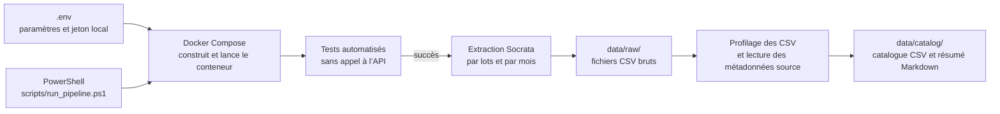

# Extraction et profilage des données des taxis de Chicago

## 1. Objectif et périmètre

Ce projet fournit une livraison minimale et reproductible pour extraire un échantillon du jeu de données des taxis de Chicago, tester le code, profiler les fichiers bruts et produire un catalogue de données. Il s’exécute sous Windows avec PowerShell et Docker Desktop.

La livraison comprend l’extraction, le profilage/catalogue, les tests automatisés et leur exécution avec Docker Compose. Elle ne comprend pas Airflow ni les traitements Spark. Aucun CSV brut ni catalogue généré n’est nécessaire au dépôt du code (execution_snapshot montre une capture prise lors de l'exécution).

## 2. Architecture de la solution

Le schéma ci-dessous présente le chemin de traitement et le rôle des principaux composants (Du travail réalisé) :



Le script PowerShell orchestre les étapes dans cet ordre : construction de l’image, tests, extraction, puis profilage et création du catalogue. Il s’arrête dès qu’une étape échoue. Docker Compose transmet les variables d’environnement au conteneur et monte le dossier `data/` pour que les résultats restent accessibles depuis Windows.

Les scripts Python contiennent la logique de traitement. Les tests valident cette logique sur des données de test et ne téléchargent pas les données réelles. Le catalogue rapproche les informations observées localement avec les métadonnées publiées par la source.

## 3. Architecture du code

```text
chicago-taxi-minimal-delivery/
├── .env                    # configuration locale, non partagée
├── .gitignore              # exclusions Git, notamment secrets et résultats générés
├── Dockerfile              # image de l’application Python
├── docker-compose.yml      # configuration du service et des variables
├── requirements.txt        # dépendances Python
├── README.md               # documentation du projet
├── scripts/
│   ├── run_pipeline.ps1    # lanceur Windows PowerShell
│   └── run_pipeline.sh     # lanceur Bash pour Git Bash ou WSL
├── src/chicago_taxi/
│   ├── ingestion/
│   │   └── extract_raw_data.py  # extraction de l’API vers les CSV bruts
│   └── catalog/
│       └── profile_data.py     # profilage et génération du catalogue
├── tests/
│   ├── test_extract_raw_data.py
│   └── test_profile_data.py
└── data/
    ├── raw/                # CSV extraits
    └── catalog/            # catalogue généré
```

### Rôle des composants

- **`scripts/run_pipeline.ps1`** lance le processus complet depuis PowerShell. L’option `-Overwrite` demande le remplacement des fichiers mensuels existants.
- **`scripts/run_pipeline.sh`** propose le même enchaînement pour Git Bash ou WSL lorsque Bash y est installé.
- **`docker-compose.yml`** définit le service applicatif, transmet la configuration et expose les sorties sous `data/`.
- **`Dockerfile`** décrit l’environnement Python conteneurisé utilisé par les tests et les scripts.
- **`requirements.txt`** liste les bibliothèques nécessaires.
- **`src/chicago_taxi/ingestion/extract_raw_data.py`** lit les paramètres, interroge l’API Socrata par lots, puis écrit les fichiers CSV mensuels. Les téléchargements utilisent les métadonnées officielles de la source pour établir les en-têtes; les erreurs temporaires font l’objet de nouvelles tentatives limitées.
- **`src/chicago_taxi/catalog/profile_data.py`** contrôle les en-têtes des fichiers, calcule le nombre de lignes, les valeurs nulles, les types observés et des exemples limités par colonne, puis écrit le catalogue CSV et son résumé Markdown.
- **`tests/test_extract_raw_data.py`** vérifie les règles et comportements de l’extraction sans appeler l’API réelle.
- **`tests/test_profile_data.py`** vérifie le profilage et la création du catalogue avec des données de test.
- **`.env`** contient les paramètres propres à l’exécution locale et le jeton Socrata. Il ne doit pas être partagé ni ajouté au contrôle de version.
- **`.gitignore`** empêche notamment l’ajout des secrets, caches et fichiers de données/catalogue générés.
- **`data/raw/`** reçoit les fichiers CSV extraits; **`data/catalog/`** reçoit les fichiers produits par le profileur.

## 4. Logique réalisée

1. **Définition de la plage et du volume.** Les dates de début et de fin exclusive déterminent les mois à traiter. `MAX_ROWS_PER_FILE` plafonne le nombre de lignes par fichier mensuel; `API_BATCH_SIZE` règle la taille des pages demandées à l’API.
2. **Récupération des métadonnées.** L’extracteur obtient les colonnes publiées par la source et s’en sert pour garder un en-tête commun. Les champs inattendus sont signalés.
3. **Extraction paginée.** Les lignes sont triées par horodatage et identifiant de course. Des tentatives limitées sont effectuées en cas d’erreur temporaire.
4. **Écriture des fichiers.** Les données sont écrites dans des fichiers temporaires puis renommées à la fin de l’écriture. Un fichier existant n’est pas remplacé sans option explicite.
5. **Profilage local.** Le profileur calcule des indicateurs descriptifs sur les CSV présents dans `data/raw/`.
6. **Construction du catalogue.** Les observations issues des CSV sont rapprochées des noms, descriptions et types documentés par la source. Deux livrables sont produits : `column_catalog.csv` et `data_catalog.md`.

L’exécution de référence décrite pour cette livraison portait sur janvier à mars 2023, avec un maximum de 50 000 lignes par fichier mensuel. Il s’agissait d’un échantillon, et non de l’extraction complète des trois mois. Les valeurs d’exécution peuvent être modifiées dans `.env`.

## 5. Configuration

Les paramètres sont définis dans le fichier local `.env` et transmis au conteneur par Docker Compose :

| Variable | Utilisation | Valeur par défaut dans Compose |
|---|---|---|
| `SOCRATA_APP_TOKEN` | Jeton d’accès à l’API Socrata | vide; à configurer localement |
| `EXTRACTION_START_DATE` | Première date incluse (`AAAA-MM-JJ`) | `2023-01-01` |
| `EXTRACTION_END_DATE_EXCLUSIVE` | Première date exclue (`AAAA-MM-JJ`) | `2023-04-01` |
| `MAX_ROWS_PER_FILE` | Maximum de lignes par CSV mensuel | `50000` |
| `API_BATCH_SIZE` | Taille d’une page demandée à l’API | `5000` |
| `RAW_DATA_DIR` | Dossier des fichiers bruts | `data/raw` |
| `CATALOG_DIR` | Dossier des fichiers du catalogue | `data/catalog` |

Ne pas publier le jeton Socrata ni le fichier `.env`. La date de fin est exclusive et doit être postérieure à la date de début.

## 6. Exécution sous Windows

Prérequis : Docker Desktop installé et démarré, et un fichier `.env` présent à la racine du projet avec les paramètres requis. Depuis PowerShell, placé dans le dossier du projet, lancer :

```powershell
./scripts/run_pipeline.ps1
```

Pour remplacer des CSV mensuels déjà présents :

```powershell
./scripts/run_pipeline.ps1 -Overwrite
```

Le script construit l’image, exécute les tests hors ligne, extrait les données puis génère le catalogue. Il retourne une erreur si Docker ou `.env` manque, ou si une étape échoue.

Le fichier Bash est une autre option, à lancer uniquement depuis Git Bash ou une distribution WSL où Bash est installé. Si `bash scripts/run_pipeline.sh` affiche `execvpe /bin/bash failed`, l’environnement WSL ne trouve pas Bash; utiliser le script PowerShell ci-dessus.

## 7. Résultats générés

Pour la plage de référence, les chemins attendus sont :

```text
data/raw/chicago_taxi_2023_01.csv
data/raw/chicago_taxi_2023_02.csv
data/raw/chicago_taxi_2023_03.csv
data/catalog/column_catalog.csv
data/catalog/data_catalog.md
```

Les CSV bruts et les catalogues sont des résultats locaux générés par l’exécution; ils ne font pas partie de la documentation ni du code source livré.

## 8. Intérêt du catalogue de données

Le catalogue réunit les définitions publiées par la ville et les observations mesurées dans les données réellement extraites. Il aide à repérer les valeurs manquantes, les types mixtes ou inattendus et les colonnes dont le contenu mérite une clarification avant toute transformation.

Il constitue un support de revue et un point de départ pour discuter d’un contrat de données. Les types observés décrivent uniquement l’échantillon profilé et ne garantissent pas le schéma de l’ensemble du jeu de données. Les définitions métier et les résultats doivent être validés sur un échantillon plus large avant un usage en production.

## 9. Éléments exclus et évolutions envisagées

### Éléments retirés du projet initial

- Airflow : DAG, planificateur, interface, base de métadonnées et journaux.
- Les traitements PySpark et l’orchestration distribuée.
- Les transformations complètes Bronze/Silver/Gold.
- Les données brutes, les catalogues générés et les secrets locaux.

### Logique cible non implémentée

1. **Bronze :** conserver les champs tels que reçus et ajouter l’heure d’ingestion, le fichier source et l’identifiant de lot.
2. **Silver :** appliquer les types validés, normaliser dates et nombres, contrôler les identifiants et les valeurs, isoler les lignes invalides et définir une règle métier pour les doublons.
3. **Contrôles de qualité :** suivre les volumes, valeurs manquantes, lignes invalides et doublons; faire échouer le flux lorsqu’un contrôle critique dépasse son seuil.
4. **Gold :** produire des indicateurs quotidiens sur les courses, recettes et distances, ainsi que des indicateurs par moyen de paiement.
5. **Orchestration :** planifier les étapes, gérer les nouvelles tentatives et rendre visibles les dépendances et les échecs.

Cette suite demande de confirmer les règles métier, notamment la définition d’un doublon, le traitement des fuseaux horaires, la précision monétaire et les seuils bloquants.

## 10. Source

Jeu de données « Courses de taxi » de la ville de Chicago, identifiant Socrata `wrvz-psew` : <https://data.cityofchicago.org/d/wrvz-psew>
